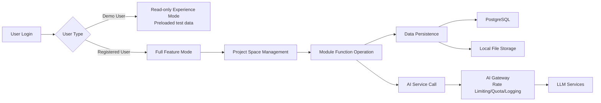

<text_never_used_51bce0c785ca2f68081bfa7d91973934># SOLVER AI 🧠
[](https://nextjs.org/)
[](https://react.dev/)
[](https://www.typescriptlang.org/)
[](https://www.prisma.io/)
[](https://www.postgresql.org/)
[](https://github.com/troy6serendipity/SOLVER-AI/actions/workflows/ci.yml)
[](#license)

[English](README.md) | [简体中文](README.zh-CN.md)

## 🎯 Product Introduction
SOLVER AI is a production-grade intelligent academic research workstation designed specifically for college students, integrating six core modules to cover the entire academic lifecycle from course learning, paper research, data analysis, experiment recording, principle verification to job preparation.

Built with real college student needs in mind, it solves common pain points such as scattered learning resources, tedious literature organization, complex data analysis, non-standard experiment records, and difficult principle understanding.

## ✨ Six Core Modules
| Module | Function |
|--------|----------|
| 📚 **Review Assistant** | Intelligent question bank generation, wrong question sorting, knowledge point association, and personalized review plan |
| 📑 **Literature Research** | PDF parsing, semantic search, note-taking, literature relationship mapping, and automatic citation generation |
| 📊 **Data Insight** | One-click import of CSV/Excel data, automatic type inference, visual analysis, and AI-powered statistical interpretation |
| 📓 **Experiment Ledger** | Standard experiment record template, data version management, result archiving, and experiment repeatability verification |
| 🔬 **Principle Lab** | Interactive simulation of professional course principles, visual algorithm demonstration, and step-by-step derivation guidance |
| 💼 **Job Assistant** | Resume intelligent optimization, interview question bank, programming problem practice, and career path recommendation |

## 🖼️ Screenshots
[!TIP]
Screenshots will be added after the first stable version is released. You can experience all features through the [Demo Environment](#demo) directly.

## 🏗️ System Architecture
```mermaid
graph TD
    A[Client Layer] -->|HTTPS| B[Next.js 16 App Router]
    B --> C[Auth.js Authentication]
    B --> D[API Route Layer]
    
    D --> E[AI Gateway]
    D --> F[Business Logic Layer]
    D --> G[File Storage Layer]
    
    E -->|Rate Limiting/Quota/Logging| H[LLM Providers (OpenAI/Anthropic etc.)]
    F --> I[Prisma ORM]
    G --> J[Local Isolated Storage]
    
    I --> K[PostgreSQL Database]
    
    style A fill:#f9f,stroke:#333,stroke-width:2px
    style B fill:#9f9,stroke:#333,stroke-width:2px
    style K fill:#99f,stroke:#333,stroke-width:2px
```

## 🔄 Core Business Flow


## 🛠️ Tech Stack
- **Frontend Framework**: Next.js 16.4.6 + React 19 + TypeScript
- **UI System**: Tailwind CSS + shadcn/ui
- **Authentication**: Auth.js v5
- **Database**: PostgreSQL + Prisma ORM v5.20
- **AI Integration**: Vercel AI SDK + Custom AI Gateway (rate limiting, quota, logging)
- **File Storage**: Local isolated storage with user isolation, signed URLs, and hash deduplication
- **Testing**: Jest + Testing Library
- **CI/CD**: GitHub Actions
- **Deployment**: Vercel

## 📁 Project Structure
```
SOLVER-AI/
├── .github/                # GitHub configuration
│   ├── workflows/          # CI/CD workflows
│   ├── ISSUE_TEMPLATE/     # Issue templates
│   └── PULL_REQUEST_TEMPLATE.md
├── docs/                   # Project documentation
├── prisma/                 # Database schema and migrations
├── public/                 # Static assets
├── src/
│   ├── app/                # Next.js App Router
│   │   ├── api/            # API routes
│   │   └── [modules]/      # Frontend pages
│   ├── components/         # Reusable UI components
│   ├── lib/                # Core business logic
│   │   ├── ai/             # AI service and gateway
│   │   ├── auth/           # Authentication utilities
│   │   ├── storage/        # File storage adapters
│   │   ├── errors.ts       # Unified error handling
│   │   └── validation.ts   # Request validation
│   └── types/              # TypeScript type definitions
├── tests/                  # Unit and integration tests
├── .env.example            # Environment variable template
├── .gitignore              # Git ignore rules
├── package.json            # Dependencies and scripts
├── tsconfig.json           # TypeScript configuration
└── next.config.ts          # Next.js configuration
```

## 🚀 Local Installation
### Prerequisites
- Node.js >= 20.0.0
- PostgreSQL >= 14.0
- npm / yarn / pnpm / bun

### Step 1: Clone the repository
```bash
git clone https://github.com/troy6serendipity/SOLVER-AI.git
cd SOLVER-AI
```

### Step 2: Install dependencies
```bash
npm install
```

### Step 3: Environment configuration
```bash
cp .env.example .env
```
Edit `.env` file and fill in the required environment variables (database connection, Auth.js secret, LLM API keys etc.)

### Step 4: Database initialization
```bash
npx prisma generate
npx prisma migrate dev
```

### Step 5: Run development server
```bash
npm run dev
```
Open [http://localhost:3000](http://localhost:3000) in your browser to access the application.

## 🧪 Testing and Building
```bash
# Run code lint
npm run lint

# Run TypeScript type check
npm run typecheck

# Run unit tests
npm run test

# Build production version
npm run build

# Start production server
npm run start
```

## 📦 Deployment
### Vercel Deployment (Recommended)
[](https://vercel.com/new/clone?repository-url=https://github.com/troy6serendipity/SOLVER-AI)

For detailed deployment instructions, please refer to [DEPLOYMENT.md](docs/DEPLOYMENT.md).

## 🔒 Security and Privacy
- **Data Isolation**: All user data is strictly isolated by user ID, no cross-user data access
- **File Security**: Files are stored in isolated directories, accessed via signed URLs with 1-hour validity
- **AI Gateway**: Rate limiting (30 requests/minute) and daily quota (100k tokens/day) to prevent abuse
- **Security Headers**: Full CSP, XSS, clickjacking, and MIME-sniffing protection enabled
- **No Data Leakage**: User-uploaded files and data are never sent to third parties without explicit user consent

## 🗺️ Roadmap
- **v1.0.0 (Current)**: Core module basic functions, data persistence, AI integration, demo mode
- **v1.1.0**: Collaboration function, team project space, real-time synchronization
- **v1.2.0**: Mobile adaptation, offline mode, progressive web application
- **v2.0.0**: Plugin system, custom module development, open platform

## 🤝 Contributing
We welcome contributions of all kinds! Please read [CONTRIBUTING.md](CONTRIBUTING.md) before submitting issues or pull requests.

## 📄 License
This project is currently in the process of confirming the open source license. Please check back later or contact the project owner for more information.

## 🙋‍♂️ Contact
If you have any questions or suggestions, please submit an Issue or contact the project maintainer.

---
⭐ If this project is helpful to you, please give us a Star!</text_never_used_51bce0c785ca2f68081bfa7d91973934>