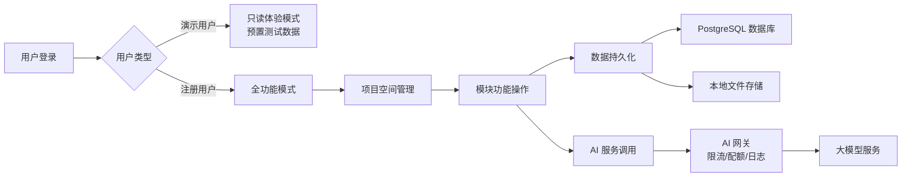

<text_never_used_51bce0c785ca2f68081bfa7d91973934># SOLVER AI 🧠
[](https://nextjs.org/)
[](https://react.dev/)
[](https://www.typescriptlang.org/)
[](https://www.prisma.io/)
[](https://www.postgresql.org/)
[](https://github.com/troy6serendipity/SOLVER-AI/actions/workflows/ci.yml)
[](#许可证)

[English](README.md) | [简体中文](README.zh-CN.md)

## 🎯 产品介绍
SOLVER AI 是一款专门为大学生设计的生产级智能学研工作台，整合了六大核心模块，覆盖从课程学习、论文研究、数据分析、实验记录、原理验证到求职准备的全学术生命周期。

我们针对大学生真实需求打造，解决学习资源分散、文献整理繁琐、数据分析复杂、实验记录不规范、原理理解困难等常见痛点，帮助大学生提高学习和研究效率。

## ✨ 六大核心模块
| 模块 | 功能说明 |
|--------|----------|
| 📚 **复习助手** | 智能题库生成、错题整理、知识点关联、个性化复习计划制定 |
| 📑 **文献研究** | PDF解析、语义搜索、笔记关联、文献关系图谱、自动引文生成 |
| 📊 **数据洞察** | CSV/Excel数据一键导入、自动类型推断、可视化分析、AI驱动的统计解读 |
| 📓 **实验台账** | 标准化实验记录模板、数据版本管理、结果归档、实验可重复性验证 |
| 🔬 **原理实验室** | 专业课程原理交互式仿真、算法可视化演示、步骤化推导指导 |
| 💼 **求职助手** | 简历智能优化、面试题库、编程题练习、职业路径推荐 |

## 🖼️ 产品截图
[!提示]
首个稳定版本发布后将补充真实产品截图，您可以直接通过[演示环境](#演示体验)体验所有功能。

## 🏗️ 系统架构
```mermaid
graph TD
    A[客户端层] -->|HTTPS| B[Next.js 16 App Router]
    B --> C[Auth.js 身份认证]
    B --> D[API 路由层]
    
    D --> E[AI 网关]
    D --> F[业务逻辑层]
    D --> G[文件存储层]
    
    E -->|限流/配额/日志| H[大模型服务 (OpenAI/Anthropic 等)]
    F --> I[Prisma ORM]
    G --> J[本地隔离存储]
    
    I --> K[PostgreSQL 数据库]
    
    style A fill:#f9f,stroke:#333,stroke-width:2px
    style B fill:#9f9,stroke:#333,stroke-width:2px
    style K fill:#99f,stroke:#333,stroke-width:2px
```

## 🔄 核心业务流程


## 🛠️ 技术栈
- **前端框架**: Next.js 16.4.6 + React 19 + TypeScript
- **UI 系统**: Tailwind CSS + shadcn/ui
- **身份认证**: Auth.js v5
- **数据库**: PostgreSQL + Prisma ORM v5.20
- **AI 集成**: Vercel AI SDK + 自定义 AI 网关（限流、配额、日志）
- **文件存储**: 本地隔离存储，支持用户隔离、签名URL、哈希去重
- **测试**: Jest + Testing Library
- **CI/CD**: GitHub Actions
- **部署**: Vercel

## 📁 项目结构
```
SOLVER-AI/
├── .github/                # GitHub 配置
│   ├── workflows/          # CI/CD 工作流
│   ├── ISSUE_TEMPLATE/     # Issue 模板
│   └── PULL_REQUEST_TEMPLATE.md
├── docs/                   # 项目文档
├── prisma/                 # 数据库 schema 和迁移文件
├── public/                 # 静态资源
├── src/
│   ├── app/                # Next.js App Router
│   │   ├── api/            # API 路由
│   │   └── [modules]/      # 前端页面模块
│   ├── components/         # 可复用 UI 组件
│   ├── lib/                # 核心业务逻辑
│   │   ├── ai/             # AI 服务和网关
│   │   ├── auth/           # 认证工具
│   │   ├── storage/        # 文件存储适配器
│   │   ├── errors.ts       # 统一错误处理
│   │   └── validation.ts   # 请求校验
│   └── types/              # TypeScript 类型定义
├── tests/                  # 单元和集成测试
├── .env.example            # 环境变量模板
├── .gitignore              # Git 忽略规则
├── package.json            # 依赖和脚本
├── tsconfig.json           # TypeScript 配置
└── next.config.ts          # Next.js 配置
```

## 🚀 本地安装运行
### 环境要求
- Node.js >= 20.0.0
- PostgreSQL >= 14.0
- npm / yarn / pnpm / bun

### 步骤 1: 克隆仓库
```bash
git clone https://github.com/troy6serendipity/SOLVER-AI.git
cd SOLVER-AI
```

### 步骤 2: 安装依赖
```bash
npm install
```

### 步骤 3: 环境变量配置
```bash
cp .env.example .env
```
编辑 `.env` 文件，填写必要的环境变量（数据库连接、Auth.js 密钥、大模型 API 密钥等）

### 步骤 4: 数据库初始化
```bash
npx prisma generate
npx prisma migrate dev
```

### 步骤 5: 运行开发服务器
```bash
npm run dev
```
在浏览器中打开 [http://localhost:3000](http://localhost:3000) 即可访问应用。

## 🧪 测试与构建
```bash
# 运行代码规范检查
npm run lint

# 运行 TypeScript 类型检查
npm run typecheck

# 运行单元测试
npm run test

# 构建生产版本
npm run build

# 启动生产服务器
npm run start
```

## 📦 部署
### Vercel 部署（推荐）
[](https://vercel.com/new/clone?repository-url=https://github.com/troy6serendipity/SOLVER-AI)

详细部署说明请参考 [DEPLOYMENT.md](docs/DEPLOYMENT.md)。

## 🔒 安全与隐私保护
- **数据隔离**: 所有用户数据严格按用户ID隔离，无跨用户数据访问
- **文件安全**: 文件存储在隔离目录，通过签名URL访问，有效期1小时
- **AI 网关**: 速率限制（30次/分钟）和日配额（10万Token/天），防止滥用
- **安全响应头**: 启用完整的CSP、XSS、点击劫持、MIME嗅探防护
- **无数据泄露**: 用户上传的文件和数据未经用户明确同意绝不会发送给第三方

## 🗺️ 开发路线图
- **v1.0.0（当前版本）**: 核心模块基础功能、数据持久化、AI集成、演示模式
- **v1.1.0**: 协作功能、团队项目空间、实时同步
- **v1.2.0**: 移动端适配、离线模式、渐进式Web应用
- **v2.0.0**: 插件系统、自定义模块开发、开放平台

## 🤝 贡献指南
我们欢迎各种形式的贡献！在提交 Issue 或 Pull Request 之前，请阅读 [CONTRIBUTING.md](CONTRIBUTING.md)。

## 📄 许可证
本项目目前正在确认开源许可证，请稍后查看或联系项目所有者获取更多信息。

## 🙋‍♂️ 联系方式
如有任何问题或建议，请提交 Issue 或联系项目维护者。

---
⭐ 如果这个项目对您有帮助，请给我们一个 Star！</text_never_used_51bce0c785ca2f68081bfa7d91973934>