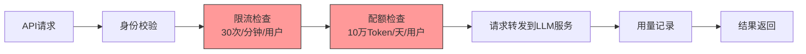
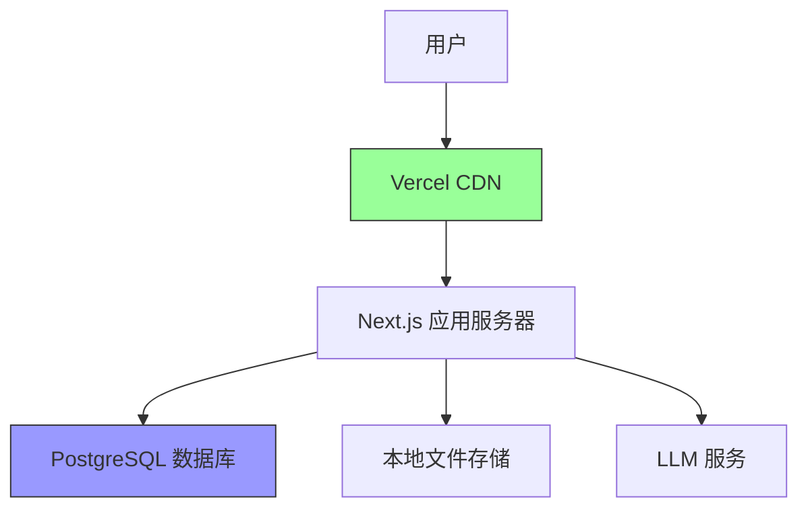

# 系统架构文档 (ARCHITECTURE.md)

## 1. 整体架构设计
SOLVER AI 采用分层架构设计，遵循高内聚低耦合原则，保证系统的可扩展性、可维护性和安全性。

### 1.1 分层架构
```mermaid
graph TD
    A[表示层 (Presentation Layer)] --> B[路由层 (Routing Layer)]
    B --> C[业务逻辑层 (Business Logic Layer)]
    C --> D[数据访问层 (Data Access Layer)]
    C --> E[服务集成层 (Service Integration Layer)]
    D --> F[数据库层 (Database Layer)]
    E --> G[外部服务层 (External Service Layer)]
```

### 1.2 各层职责
- **表示层**: 基于React 19和Next.js App Router的前端界面，负责用户交互和数据展示
- **路由层**: Next.js API路由，负责请求分发、身份认证、权限校验
- **业务逻辑层**: 核心业务逻辑实现，包括六大模块的业务规则处理
- **数据访问层**: Prisma ORM封装，负责数据库操作，屏蔽底层数据库差异
- **服务集成层**: 外部服务集成，包括AI大模型、文件存储、邮件服务等
- **数据库层**: PostgreSQL关系型数据库，存储所有业务数据
- **外部服务层**: 第三方服务，包括LLM服务、对象存储、邮件服务等

## 2. 核心子系统设计

### 2.1 身份认证子系统
- 基于Auth.js v5实现，支持邮箱密码、OAuth2第三方登录
- 支持演示用户模式，预置测试数据，只读权限控制
- Session存储采用HttpOnly Cookie，防止XSS攻击
- 权限校验中间件，对所有API请求进行权限控制

### 2.2 AI网关子系统

- 统一AI服务入口，支持多LLM厂商切换
- 实现速率限制、配额管理、用量统计
- 自动日志记录，便于问题排查和费用统计
- 支持故障转移，自动切换备用LLM服务

### 2.3 文件存储子系统
- 本地隔离存储，按用户ID分目录存储
- 文件哈希去重，节省存储空间
- 签名URL访问，有效期1小时，防止未授权访问
- 支持PDF、图片、文档三类文件，大小限制分别为10MB、5MB、20MB

### 2.4 项目空间子系统
- 多项目隔离，用户可以创建多个独立项目
- 支持项目任务管理，TODO列表功能
- 数据按项目隔离，支持项目级权限控制
- 支持资源关联，文件、文献、数据集都关联到所属项目

## 3. 技术选型决策
| 技术 | 选型理由 | 替代方案 |
|------|----------|----------|
| Next.js 16 | 支持App Router、服务端组件、内置优化，适合全栈应用 | Nuxt、Remix |
| Prisma ORM | 类型安全、迁移管理简单、开发效率高 | TypeORM、Drizzle |
| PostgreSQL | 关系型数据库，支持复杂查询、事务、JSON字段，适合业务数据存储 | MySQL |
| Auth.js | 多认证方式支持、Next.js深度集成、安全性高 | NextAuth v4、自定义认证 |
| Vercel AI SDK | 多LLM厂商统一接口、流式响应支持、开发效率高 | 自定义LLM封装 |

## 4. 非功能设计

### 4.1 安全设计
- 输入校验：所有用户输入都进行严格校验，防止SQL注入、XSS攻击
- 输出编码：所有输出到前端的内容都进行编码，防止XSS攻击
- CSP头：内容安全策略，限制资源加载来源
- X-Frame-Options：防止点击劫持
- X-Content-Type-Options：防止MIME嗅探
- 权限控制：所有操作都进行权限校验，防止越权访问

### 4.2 性能设计
- 前端缓存：静态资源CDN缓存，API响应缓存
- 数据库优化：索引优化，查询优化，避免N+1查询
- 异步处理：耗时操作异步处理，不阻塞主流程
- 限流降级：AI网关限流，防止系统被打垮

### 4.3 可扩展性设计
- 模块化设计：六大模块相互独立，便于新增和修改
- 插件化架构：AI网关支持新增LLM厂商，存储层支持新增存储方式
- 微服务 readiness：核心子系统独立，便于未来拆分微服务

## 5. 部署架构

- 前端和API都部署在Vercel平台，自动扩缩容
- 数据库采用托管PostgreSQL服务（如Supabase、Neon）
- 文件存储可以根据需求切换为对象存储服务（如S3、OSS）